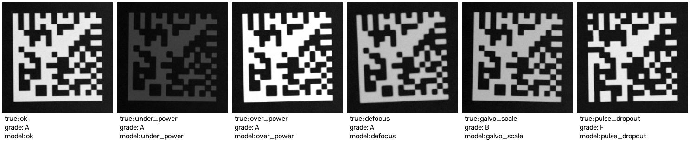

# Laser Mark Inspector

[](https://github.com/Jimmply/laser-mark-inspector/actions/workflows/ci.yml)


**Final-product quality check for laser-marked 2D DataMatrix codes on black-anodized aluminum.** It decodes and grades each mark using the ISO/IEC TR 29158 (AIM DPM) grade bands. A classifier then names the likely laser-process fault, because a passing grade doesn't mean the process is in spec.



*Three of these five faulty marks still grade **A**, and galvo grades B. The verifier passes them; the root-cause model names the fault on all five.*

## Why this matters

Aerospace and medical customers commonly require part marks to be verified, not just read. Typical sources are AS9132 and MIL-STD-130 for aerospace and FDA UDI direct marking for medical. The usual method for direct part marks is ISO/IEC TR 29158. A verifier gives a letter grade, but it doesn't say *why* a mark degraded, or warn when the process is drifting while marks still pass. This project does both.

## Results

1,200 simulated marks, one per process scenario, 200 each. The root-cause classifier is evaluated on a stratified 20% test split (240 marks):

| Metric | Value |
|---|---|
| In-spec marks graded A | **200 / 200** (no false rejects) |
| Faulty marks that still graded **A** | **560 / 1,000 (56%)**, invisible to the grade alone |
| Root-cause accuracy (6 classes) | **0.988** |
| Baseline: predict from grade + decode only | 0.404 |
| Baseline: majority class | 0.167 |
| Faulty-but-graded-A test marks flagged as faulty | **107 / 108 (99.1%)** |

**Most important features:** sharpness 0.22, axial non-uniformity 0.19, cell contrast 0.16, dot growth 0.16. Raw mark brightness carries only 0.04, because camera exposure and dye batch vary on purpose in the simulator (see below). That keeps the model on signals that survive a lighting change.

**Read the 0.988 with care.** In this simulator each fault has a distinct physical signature, so the number is an upper bound. See [Limitations](#limitations).

## Stress test: two faults at once

The classifier is trained on **one fault at a time**. A real line can drift on two knobs together, so [`scripts/eval_combined.py`](scripts/eval_combined.py) renders 360 marks with **two simultaneous faults** (9 pairs × 40) that the model never saw, and checks what it does:

| Metric | Value |
|---|---|
| Two-fault marks that still graded **A** | 17.5% |
| Flagged as faulty (not "ok") | **100%** |
| Named one of the two real faults | **92.8%** |

Seven of the nine pairs are named correctly every time. The two weak spots both involve under-power:

| Pair | Named a real fault | Most common miss |
|---|---|---|
| under_power + defocus | 72% | **over_power** (11 / 40) |
| under_power + pulse_dropout | 62% | over_power (7 / 40), defocus (8 / 40) |

**Why it matters:** blur from defocus spreads the mark, which resembles the dot growth caused by too much power. An operator who followed that call would turn power **down** on a mark that is already too weak. Until the model is trained on combined faults, an "over_power" call on a low-contrast mark should be double-checked against a power-meter reading.

The app does this automatically: an "over_power" call with no decode and a dim mark (mean light level < 130) shows a warning. On a fresh sample this rule caught 36 of 38 wrong-direction calls, and put a caution on 25 of 146 (17%) real over-power marks.

## What's graded

Each graded parameter uses its published band thresholds. The overall grade is the worst parameter grade, as in the standard.

| Parameter | How it's measured | A | B | C | D |
|---|---|---|---|---|---|
| Decode | Reference decode succeeds (zxing-cpp) | pass | – | – | – |
| Cell Contrast | (L − D) / L from module-center samples | ≥ 0.30 | ≥ 0.25 | ≥ 0.20 | ≥ 0.15 |
| Axial Non-uniformity | X vs Y module pitch from the symbol's corners | ≤ 0.06 | ≤ 0.08 | ≤ 0.10 | ≤ 0.12 |
| Unused Error Correction | Reported by the decoder | ≥ 0.62 | ≥ 0.50 | ≥ 0.37 | ≥ 0.25 |

Thresholds as published in Cognex's documentation of [ISO/IEC TR 29158 (AIM DPM)](https://docs.cognex.com/dmst_617/web/EN/DM475V_Manual/Content/Topics/DM475V/TruCheck/AIM_DPM.htm) and [ISO/IEC 15415](https://docs.cognex.com/vpro_970/web/EN/help/html/Properties_T_Cognex_VisionPro_ID_CogIDProcessControlMetricsAIMDPM.htm).

**Not implemented:** Cell Modulation, Fixed Pattern Damage, Grid Non-uniformity and Minimum Reflectance. This is a portfolio verifier, not a calibrated instrument. It has no reflectance calibration card and no certified optics.

## How the marks are simulated

On black anodize the laser bleaches the dye, which leaves a light mark on a dark surface. [`src/mark_generator.py`](src/mark_generator.py) models that per pixel:

- **Dose** D = (P / P_nom) · (v_nom / v), spread by a Gaussian beam whose width grows with defocus.
- **Bleaching** starts above a dose threshold and saturates exponentially toward the bleached reflectance.
- **Burn-through:** above a higher dose the laser ablates to bare aluminum, which reads as speckled grey under diffuse light.
- **Machine faults:** galvo X-scale error stretches the symbol, and pulse dropout leaves cells unmarked.
- **Nuisance variation that is not a laser fault:** camera exposure (±25%), anodize dye batch (±15%), surface mottle, lighting gradient, sensor noise and ±3° rotation.

Six scenarios with their operator actions:

| Fault | Typical grade signature | What the operator should do |
|---|---|---|
| ok | A | Nothing |
| under_power | Usually still A on anodize, lower contrast | Raise power or slow the scan; check output with a power meter |
| over_power | A until burn-through breaks decoding | Lower power; bare Al hurts readability |
| defocus | Mostly A, soft edges | Re-check focal height and fixturing |
| galvo_scale | Axial non-uniformity B–F | Re-run galvo field calibration |
| pulse_dropout | Usually F (no decode) | Inspect Q-switch, seed laser and fiber connection |

Fault severities start just outside the in-spec window, so mild faults look like normal variation.

## Limitations

- **Synthetic data.** Every fault has a clean physical signature here. Real marks will add combined faults, real optics, scratches and glare, so expect lower accuracy on a real line. The next step is collecting real verifier images from a production marker.
- **Trained on one fault at a time.** On two-fault marks it still flags every one, but it can name the wrong power direction (see the stress test above). Training on combined faults is the next step.
- **Grid from re-encoding.** The grader re-encodes the decoded text to get the ideal module pattern, which assumes the marker used the minimal symbol size. If the decoder reports a different size, it logs a warning.
- **Square DataMatrix only.**

## Quickstart

```bash
git clone https://github.com/Jimmply/laser-mark-inspector.git
cd laser-mark-inspector
python -m venv .venv && source .venv/bin/activate
pip install -r requirements.txt

python scripts/generate_data.py     # 1,200 graded marks -> data/marks.csv (~3 s)
python scripts/train.py             # root-cause model -> models/
python scripts/eval_combined.py     # stress test on two-fault marks
streamlit run src/app.py            # move the laser sliders, or upload your own mark photo
pytest                              # 21 tests
```

## Project structure

```
laser-mark-inspector/
├── config/settings.yaml          # process nominals, anodize physics, dataset + model settings
├── scripts/
│   ├── generate_data.py          # simulate + grade marks -> data/marks.csv
│   ├── train.py                  # root-cause classifier + baselines -> models/
│   ├── eval_combined.py          # two-fault stress test
│   └── make_gallery.py           # README hero image
├── src/
│   ├── mark_generator.py         # DataMatrix rendering on anodized Al with laser physics
│   ├── grader.py                 # decode + ISO/IEC TR 29158 grade bands
│   ├── root_cause.py             # fault classifier, baselines, hidden-fault recall
│   └── app.py                    # Streamlit inspector
└── tests/                        # generator, grader, leakage + baseline guards
```

## Author

**Dmitry Shurkhai**, Manufacturing Data Scientist. [GitHub](https://github.com/Jimmply) · [LinkedIn](https://linkedin.com/in/etozhejimmy)
